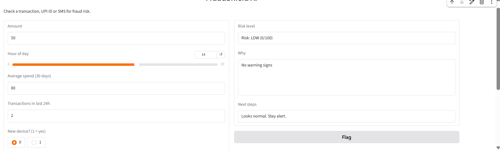
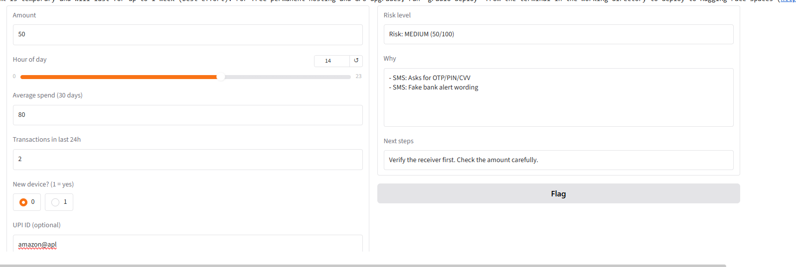
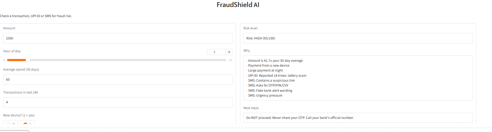

# FraudShield AI
Live Demo:https://a474b1b7644f720b45.gradio.live

An AI-powered fraud detection tool that checks transactions, UPI IDs and SMS messages for fraud risk and explains why.

## Features
1. SMS Scam Detector
2. Transaction Fraud Detection (Random Forest model)
3. UPI ID Risk Checker
4. OTP Verification Simulation (demo only)
5. Smart Fraud Alert System (Low / Medium / High with reasons and next steps)

## How to Run

1. Open `Fraud_detection (3).ipynb` in Google Colab.
2. Click Runtime → Run all.
3. Wait for the final cell to start the Gradio app.
4. Open the new `gradio.live` link shown in the output.
5.

## Screenshots

## Limitations
- Data is simulated
- UPI list and SMS rules are demo data
- OTP is simulated only

## Future scope
Real datasets, a trained SMS spam model, bank API integration.
